  <picture>
    <source media="(prefers-reduced-motion: reduce)" srcset="./abdul-hero-static.svg">
    
  </picture>

 

<table>
<tr>
<td width="210" align="center" valign="top">

</td>
<td valign="top">

## About

2026 B.E. Computer Science (Data Science) graduate from Bengaluru with a strong base in Python, SQL, data engineering and analytics. I build ETL pipelines, clean real-world datasets, integrate REST APIs, and turn raw numbers into dashboards and recommendations people can act on.

I'm looking for **Data Analyst**, **Data Engineer** and **Data Scientist** roles.

</td>
</tr>
</table>

---

## Experience

**AI Fellow Intern**, Bharati Unnati AI Fellowships · *Jan 2026 – May 2026*
- Assessed structured datasets for anomalies, data quality failures and patterns, and documented findings for the wider team.
- Built and deployed AI-driven data pipelines in Python that automated extraction, transformation and reporting.
- Used SQL and Python analytics to quantify process improvements from automation.

## Education

**B.E. Computer Science & Engineering (Data Science)**, Nagarjuna College of Engineering & Technology, Bengaluru · *2022 – 2026* · First Class, no academic backlogs

## Certifications

- Oracle OCI 2025: Certified Data Science Professional
- Oracle OCI 2025: Certified Generative AI Professional
- NPTEL: Large Language Models
- DevOps GitLab CI/CD: AWS, Docker, Java & Python Automation
- AWS Essentials: A Complete Beginner's Guide

---

## Selected Projects

| Project | What it does | Stack |
|---|---|---|
| **[MarketMind](https://github.com/geniusInCode/MarketMind)** | Google Ads vs Meta Ads analytics on 500 campaign records. Engineers 8 KPIs (CTR, CVR, CPC, CPA, ROAS, ROI), runs an A/B t-test for budget allocation, and shows a ROAS heatmap and a Chart.js dashboard. | Python, SQL, Pandas, SciPy, Chart.js, Flask |
| **[CustomerIQ](https://github.com/geniusInCode/CustomerIQ)** | Segments 4,000+ customer transactions into four groups using RFM metrics and KMeans, with Logistic Regression for churn-risk signals and SQL views for city revenue and quarterly cohort retention. | Python, SQL, Pandas, KMeans, Logistic Regression, Flask |
| **[DataPulse](https://github.com/geniusInCode/DataPulse)** | Cleans and assesses 580+ sales records, validates patterns with Shapiro-Wilk, one-way ANOVA and A/B t-test, and serves 4 chart types through a REST API dashboard. | Python, SQL, Pandas, Scikit-Learn, SciPy, Matplotlib, Seaborn |

---

## Skills

| | |
|---|---|
| **Data analysis** | Python (Pandas, NumPy, SciPy), SQL (JOINs, CTEs, aggregations, subqueries), EDA, anomaly detection, data cleaning |
| **Data engineering** | ETL pipeline design, data transformation, REST API integration, feature engineering, data quality validation |
| **BI & visualisation** | Power BI, Tableau, Looker Studio, Apache Superset, Matplotlib, Seaborn, Chart.js |
| **Statistics** | Hypothesis testing, A/B testing (t-test), ANOVA, Shapiro-Wilk, regression analysis |
| **AI & ML** | Scikit-Learn (regression, classification, clustering), Generative AI, LLMs, prompt engineering |
| **Spreadsheets** | Advanced Excel (pivot tables, XLOOKUP, INDEX/MATCH), Google Sheets |
| **Tools** | Git, GitHub, Jupyter Notebook, VS Code, Postman |

---

## Contribution Heatmap

  
   
  Live data from my GitHub contributions.

## GitHub Stats

  
  

---

  <picture>
    <source media="(prefers-reduced-motion: reduce)" srcset="./abdul-footer-static.svg">
    
  </picture>

